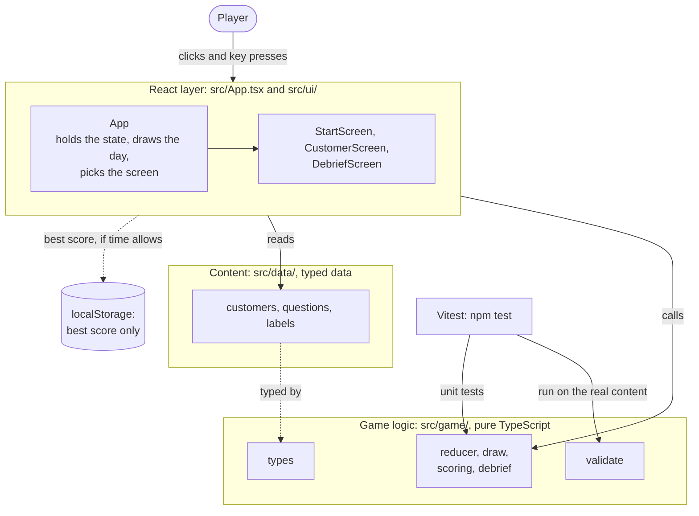
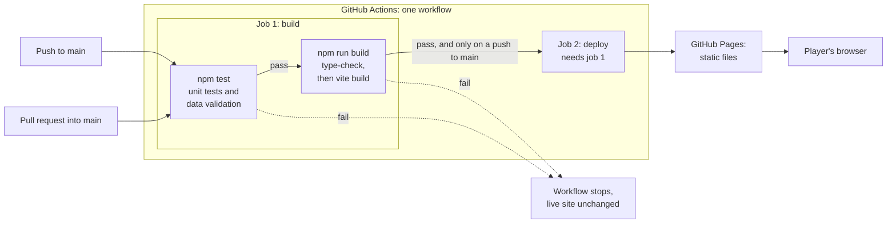

# Hold the Line: architecture

Version 6, Sat Nov 28, 2026. Built on [requirements.md](requirements.md) version 6. Version 2 recorded the approval of D16 and D17 and added what the UI design needs: a shared `Slip` component and a single `buildDebrief` call. Version 3 follows the approval of D19 and D20: the decision guard in `CustomerScreen` and the source links in `DebriefScreen`. This document covers the system architecture, the folder layout, what each module is responsible for, and the technical decisions. Version 4 applies four decisions from the security and test-plan step: tests on pull requests (D23), the Content-Security-Policy added at build time (D25), the rules test (D28), and messages for rules about the whole pool (D32). Version 5 records what the game-logic step built (PR #7), as Jeff approved it: the test helper `testPool.ts` in the folder layout, the name `GameContent`, the start of each message from `validateData`, and the cases in which `drawDay`, `scoreDay`, and `buildDebrief` throw. Version 6 records what the UI step built (PR #11): three helper modules in `src/ui/`, and the half-second guard, which covers the question buttons too and compares two timestamps rather than running a timer. The game flow and the data schema are in [design.md](design.md). Security is in [security.md](security.md), and the test strategy is in [test-plan.md](test-plan.md).

`src/game/` and `src/data/` are implemented (PR #7, PR #10), and so are `App.tsx` and `src/ui/` (PR #11). This is what the code will be checked against, and it is brought in line with what was built on Dec 5.

## 1. System overview

Hold the Line is a static single-page app. All customer content is compiled into the bundle, so after the page loads the game makes no network requests (NFR-1). There is no server, no account, and nothing stored except the best score (NFR-2).

The code is in three layers, and dependencies only point one way. All three are compiled into one static bundle that runs in the browser. Vitest runs the game logic and the content checks outside the browser.



The rules the diagram shows:

1. `src/game/` imports nothing from React, the DOM, `src/ui/`, or `src/data/`. It is plain TypeScript that runs the same in a browser and in a test (NFR-8).
2. `src/data/` imports only types from `src/game/types.ts`. It contains text and numbers, no logic.
3. `src/ui/` and `App.tsx` are the only code that touches React, the DOM, `Math.random`, or `localStorage`. Components render state and dispatch actions. They do not score, draw, or decide what a flag's label is.

A game rule can then be tested without rendering anything, and a content change cannot break a rule without `npm test` saying so.

## 2. Build and delivery



- `npm test` is `vitest run`. It runs the unit tests, the data validation test (FR-15), and the rules test (D28).
- `npm run build` is `tsc -b && vite build`, so a type error also stops a deploy. A few lines in `vite.config.ts` add the Content-Security-Policy `<meta>` tag to the built `index.html` only (D25, security.md SEC-12).
- The workflow runs on a push to `main` and on a pull request into `main` (D23). The deploy job has `needs:` on the build job and runs only for a push to `main`, so a pull request is tested and built but never deployed. A failing test or build means the deploy job never starts (FR-16, AC-8.2).
- Vite's `base` is `/hold-the-line/`, because the site is served from `https://jeff-meendering.github.io/hold-the-line/` (plan risk 8).
- The workflow's permissions, triggers, and action versions are specified in [security.md](security.md) (SEC-5 to SEC-9).

## 3. Folder layout

```text
hold-the-line/
├── index.html
├── package.json
├── vite.config.ts            Vite and Vitest settings, base path, CSP at build
├── tsconfig.json             strict mode
├── CLAUDE.md                 instructions for the coding agent
├── .github/workflows/
│   └── deploy.yml            test, build, deploy
├── docs/
├── screenshots/
└── src/
    ├── main.tsx              mounts <App />
    ├── App.tsx               state, day draw, screen switch
    ├── styles.css
    ├── rules.test.ts         layer rules and banned APIs
    ├── game/                 pure TypeScript, no React or DOM
    │   ├── types.ts
    │   ├── rng.ts
    │   ├── draw.ts           + draw.test.ts
    │   ├── reducer.ts        + reducer.test.ts
    │   ├── scoring.ts        + scoring.test.ts
    │   ├── debrief.ts        + debrief.test.ts
    │   ├── validate.ts       + validate.test.ts
    │   └── testPool.ts       made-up customers for the unit tests
    ├── data/                 content only
    │   ├── questions.ts
    │   ├── labels.ts
    │   ├── customers.ts
    │   └── data.test.ts
    └── ui/                   React components
        ├── StartScreen.tsx
        ├── CustomerScreen.tsx
        ├── DebriefScreen.tsx
        ├── Slip.tsx          used by both screens above
        ├── bestScore.ts      should: FR-17
        ├── format.ts         text built from more than one value
        ├── customerView.ts   what CustomerScreen sees, its question states, the guard
        └── useHeadingFocus.ts  focus to a screen's heading when it appears
```

The wireframes in design.md section 4 need one shared component, `Slip`, because the customer screen and the debrief both show the slip. Any other split of a screen into smaller components also goes in `src/ui/`. The three helper modules hold plain functions, and `format.ts`, `customerView.ts`, and `bestScore.ts` each have a `.test.ts` beside them that runs in Node like the tests in `src/game/`. They render nothing, so they are not the component tests D16 leaves out.

## 4. Module responsibilities

The types named here are defined in [design.md](design.md).

**`src/game/`: pure logic**

| Module | Responsibility | Main export | Covers |
|---|---|---|---|
| `types.ts` | The schema: customers, slips, red flags, game state, actions, and the lists of valid ids and source hosts | Types and `as const` id lists | FR-11, FR-12 |
| `rng.ts` | A seeded random source for tests, about 10 lines | `mulberry32(seed): () => number` | AC-5.3 |
| `draw.ts` | The day draw, rules 1 to 7 in requirements section 6. Takes its random source as a parameter. Throws on a pool smaller than 3 scam and 5 legit customers, instead of giving a short day | `drawDay(pool, rng): Customer[]` | AC-5.1 to 5.3, NFR-8 |
| `reducer.ts` | Every state change: start a day, ask a question, decide. Enforces the limit of 3 questions and no repeats. Ignores an action that is not allowed | `gameReducer(state, action): GameState` | FR-2, FR-4 to FR-6, FR-10 |
| `scoring.ts` | The scoring table and the floor at 0. `sumPoints` is the total before the floor, which `buildDebrief` uses for `floored`. `scoreDay` and `sumPoints` throw if the day and the results differ in length | `pointsFor(truth, decision): number`, `scoreDay(day, results): number`, `sumPoints(day, results): number` | Requirements section 5, AC-6.1 |
| `debrief.ts` | Builds everything the debrief shows: the score, whether it was raised to 0, the counts, and for each customer the call, the truth, right or wrong, the points, and each flag's status of *shown*, *you asked*, or *you didn't ask* | `buildDebrief(day, results): Debrief`. Throws, through `sumPoints`, if the day and the results differ in length | FR-8, FR-9, AC-6.2, AC-6.3 |
| `validate.ts` | Checks content against the rules in design.md section 2.6 and returns one message per problem found, each starting with the customer id or question id, with the transaction type for a rule about a question set, or with `pool` for a rule about the whole pool. It never throws on bad content | `validateData(content: GameContent): string[]`, where `GameContent` is `{ questionText, questionSets, customers }` | FR-15, AC-8.1, AC-8.3 |

**`src/data/`: content**

| Module | Responsibility | Covers |
|---|---|---|
| `questions.ts` | The wording of the 8 bank questions and the set of 5 for each transaction type | FR-18 |
| `labels.ts` | Display text for each red flag id, scam type, and transaction type | FR-9 |
| `customers.ts` | The pool of 10 customers, in one file so it can be pasted whole into a review | FR-11 to FR-14 |
| `data.test.ts` | Runs `validateData` on the real content and expects no messages | FR-15 |

**`src/game/testPool.ts`: test helper.** Builds made-up customers with placeholder text for the unit tests (test-plan.md section 1, rule 2). It is not a test file, so the rules test reads it like the rest of `src/game/`, and nothing in the app imports it, so it is not in the bundle. It holds no source URLs, because web addresses may appear only in `src/data/customers.ts`, and it writes out its own copy of the three question sets so the unit tests do not read real content.

**`src/` and `src/ui/`: React**

| Module | Responsibility | Covers |
|---|---|---|
| `main.tsx` | Mounts `App` and loads `styles.css` | |
| `rules.test.ts` | Reads every source file that is not a test, as text, and fails if one breaks a layer rule or uses a banned API. The rules are in test-plan.md section 4 | NFR-8, NFR-9, SEC-4, SEC-10, SEC-16, SEC-18 |
| `App.tsx` | Holds the game state with `useReducer(gameReducer)`. On Start and Play again it calls `drawDay(customers, Math.random)` and dispatches the result. Renders the screen that matches `state.phase` | FR-2, FR-10 |
| `StartScreen.tsx` | Title, how-to-play text, Start button, best score | FR-1, FR-17 |
| `CustomerScreen.tsx` | Slip, behaviour text, question list, answers, Process and Hold. Receives a `CustomerView`, which has no truth, flags, or explanation. Holds the half-second guard (D19): the question buttons, Hold, and Process ignore presses for half a second after a customer appears. It compares two timestamps, the time of the screen's first render and the time of the press, so there is no timer to start or clear | FR-3 to FR-7 |
| `DebriefScreen.tsx` | Calls `buildDebrief` and renders the result, including the source links on scam cards and the look-alike part of legit cards (D20). Play again button | FR-8 to FR-10 |
| `Slip.tsx` | Renders a slip for any of the three transaction types, in full on the customer screen and in short form on a debrief card | FR-3, FR-8 |
| `bestScore.ts` | Reads and writes one number in `localStorage`, inside `try`/`catch`, so the game works without storage | FR-17, NFR-2 |
| `format.ts` | The text the screens build from more than one value: money, points, the transaction line, the short slip, the outcome sentences, the counts, the points key, and the source link text taken from the URL's hostname | FR-8, FR-9, SEC-14 |
| `customerView.ts` | `toCustomerView`, which copies the four fields `CustomerScreen` may see; the questions in bank order and their three states; and the guard, `pastGuard` and `acceptsQuestion` | FR-4 to FR-7, D19 |
| `useHeadingFocus.ts` | Moves focus to a screen's heading and scrolls to the top when the screen or the next customer appears | NFR-5, U9 |

## 5. Dependencies

| Package | Kind | Why it is there |
|---|---|---|
| `react`, `react-dom` | Runtime | The UI |
| `vite`, `@vitejs/plugin-react` | Dev | Dev server and build. The plugin is what lets Vite compile React |
| `typescript`, `@types/react`, `@types/react-dom` | Dev | The compiler and React's type definitions |
| `vitest` | Dev | Test runner |

These eight packages are what React, Vite, TypeScript, and Vitest need to work together. Nothing else is added. Versions are whatever is stable when the app is scaffolded on Nov 29, and `package-lock.json` pins them. React is the only code of any size in the bundle. NFR-7's 200 kB limit is checked against the first build's output, not estimated here.

## 6. Technical decisions

| # | Decision | Considered | Why |
|---|---|---|---|
| T1 | Game state is one `useReducer` in `App`, with the reducer in `src/game/reducer.ts` | `useState` in each screen; Zustand or Redux; XState | NFR-8 asks for game state as a pure function, and a reducer is one. It is built into React, and `reducer.test.ts` can play a whole day with no browser. A store library solves sharing state across a large component tree, and this app has three screens under one parent. XState would give a formal state machine for a game that has three states. |
| T2 | The screen is chosen by `state.phase`. No router | React Router; hash routes | The game has no URLs to share. A reload must return to the start screen (FR-10, D8), and with a router each screen would have a URL that a reload has to redirect away from. Client-side routes also need a 404 workaround on GitHub Pages. |
| T3 | Randomness comes in at the edge. `drawDay(pool, rng)` takes the random source; `App` passes `Math.random` and dispatches the drawn day; tests pass `mulberry32(seed)` | Drawing inside the reducer; a seed carried in the action; the `seedrandom` package; mocking `Math.random` in tests | A reducer that calls `Math.random` is not pure, and React's strict mode runs reducers twice in development to catch exactly that. A seed in the action would be pure, but the reducer would then need the customer pool and the random generator for no gain. `mulberry32` is about 10 lines, so a package is not worth a dependency. Passing the source as a parameter is what NFR-8 asks for, and it makes AC-5.1 to AC-5.3 plain unit tests. |
| T4 | Content is TypeScript modules imported into the bundle | JSON files fetched at runtime; JSON checked by a schema library such as Zod | A `.ts` file gets editor and compiler checking against the schema for free. It is bundled, so there is no extra request (NFR-1) and no loading or error state to build. A schema library would be a runtime dependency that checks things `validateData` has to check anyway, such as the cross-customer rules in FR-13 and FR-14. |
| T5 | Content rules are checked by a pure function, `validateData`, that returns a list of messages. One test runs it on the real content, and another feeds it broken content | Assertions written directly in a test; relying on the types alone | Returning messages lets one run report every problem and makes AC-8.1 testable: break a copy of a customer and expect a message with its id. The types cannot do it alone. Vitest strips types without checking them, so `npm test` would pass on a customer with a missing field, and no type can express "at least 3 legit customers have a look-alike trait". `validateData` therefore checks its input at runtime, even though it is typed. |
| T6 | Hidden information is kept hidden by the structure. `CustomerScreen` takes a `CustomerView` type without the truth, flags, or explanation. The score and flag statuses are computed only when `DebriefScreen` calls `buildDebrief`, and are never in the state | A convention in `CLAUDE.md` only; separate public and secret data files | FR-7 is the rule a small UI change is most likely to break. With the narrower type, reading `customer.truth` in the customer screen is a compile error. With the score computed only at the debrief, there is no score in memory to show early by accident. Splitting the files would make each customer harder to write and review. The truth is still in the JavaScript a player downloads, which `security.md` records as accepted. |
| T7 | One plain CSS file, with custom properties for colours and spacing | CSS Modules; Tailwind; a component library | Three screens do not have a class-name collision problem. No build setup, nothing to learn, and nothing added to the bundle. The plan rules out custom art and makes polish a "should". |
| T8 | Tests run in Vitest's default Node environment and cover `src/game/` and `src/data/` only | Adding `jsdom` and React Testing Library for component tests | See D16. Every rule is in a pure function, so the components are thin, and the acceptance criteria about what is on screen are in the manual test plan. `rules.test.ts` reads the source files as text and renders nothing (D28). |
| T9 | One workflow with two jobs, using GitHub's own Pages actions | The `gh-pages` npm package pushing to a branch; a single job; separate test and deploy workflows | FR-16 asks for one workflow. Two jobs make AC-8.2 visible in the Actions tab: when a test fails, the deploy job shows as skipped. The official actions deploy an uploaded artifact and need no write access to the repository's contents. |
| T10 | npm, strict TypeScript, and no linter or formatter | ESLint with the React plugins, as in Vite's template; Prettier | See D17. `tsc` in strict mode runs in the build and is the static check. |
| T11 | The best score is read and written by `bestScore.ts`, called from the components, never from the reducer | Storing it in the game state; a persistence library | Storage is a side effect, and the reducer has to stay pure. It is one number, so two functions with a `try`/`catch` are enough (FR-17). |

## 7. Decisions for Jeff

The numbering continues from [requirements.md section 8](requirements.md#8-decisions). D14, D15, and D18 to D21 are about the schema and the UI and are in [design.md section 6](design.md#6-decisions).

| # | Decision | Recommendation | Why | Status |
|---|---|---|---|---|
| D16 | Component tests | None. Do not add `jsdom` or React Testing Library | The plan's cut order treats component tests as planned but cuttable (item 5). They need two or three more dev dependencies and a test environment to set up, out of 6.5 hours of coding. The logic they would exercise is already unit-tested in `src/game/`, and what is left is whether the right text is on screen, which the manual test plan checks against each acceptance criterion. The plan's cut order was updated to match. | Approved by Jeff, Nov 27 |
| D17 | Linter and formatter | Leave both out | Vite's React template comes with ESLint and about six dev dependencies. Strict `tsc` already stops a build on type errors, and each extra package is something `security.md` has to account for. The cost is that nothing checks React's hook rules, which matters little with one `useReducer` and a few small effects (moving focus and saving the best score). | Approved by Jeff, Nov 27 |
