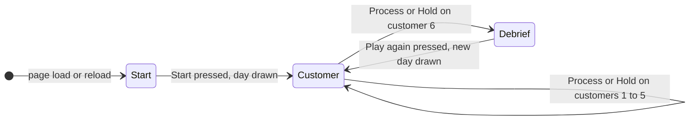

# Hold the Line: design

Version 1 (part 1 of 2), Fri Nov 27, 2026. Built on [requirements.md](requirements.md) version 3. This part covers the game flow and the data schema, with the decisions behind them. The UI and UX plan and the wireframes are added in the next step. The system architecture and the technical decisions are in [architecture.md](architecture.md).

## 1. Game flow

The game is in one of three phases. The whole game state is the value below, held in memory only.



### 1.1 State and actions

```ts
// src/game/types.ts (game state)

export type Decision = 'process' | 'hold';

/** What the player did with one customer. results[i] belongs to day[i]. */
export interface CustomerResult {
  asked: QuestionId[];
  decision: Decision;
}

export type GameState =
  | { phase: 'start' }
  | {
      phase: 'customer';
      day: Customer[]; // the 6 customers, in drawn order
      index: number; // which customer is at the window, from 0
      asked: QuestionId[]; // questions asked of this customer so far
      results: CustomerResult[]; // one per customer already decided
    }
  | { phase: 'debrief'; day: Customer[]; results: CustomerResult[] };

export type Action =
  | { type: 'startDay'; day: Customer[] }
  | { type: 'ask'; questionId: QuestionId }
  | { type: 'decide'; decision: Decision };

export const MAX_QUESTIONS = 3;
```

### 1.2 Transitions

| In phase | Action | Allowed when | Result | Covers |
|---|---|---|---|---|
| `start` or `debrief` | `startDay` | Always | `customer`, with the new day, `index` 0, and nothing asked or decided | FR-2, FR-10, AC-7.1 |
| `customer` | `ask` | The current customer has an answer to the question, it has not been asked, and fewer than 3 have been asked | Same phase, with the question added to `asked` | FR-4, FR-5, AC-3.2, AC-3.3 |
| `customer` | `decide` | A customer after this one remains | Same phase: the result is recorded, `index` goes up by 1, `asked` is emptied | FR-6, AC-4.1, AC-4.2 |
| `customer` | `decide` | This is the last customer | `debrief`, with all 6 results | FR-8, AC-6.1 |
| Any | Any other combination | | The state is returned unchanged. No action goes back to an earlier customer | AC-4.3 |

### 1.3 What each phase can show

| Phase | On screen | Never on screen |
|---|---|---|
| `start` | Title, how-to-play text, Start, best score | The number or range of scams (FR-1) |
| `customer` | "Customer *n* of 6", name, slip, behaviour text, the 5 questions, the answers revealed so far, questions left, Process and Hold | Truth, red flags, scam type, explanation, score, right or wrong for any earlier customer (FR-7) |
| `debrief` | Score, and for each customer the call, the truth, right or wrong, the flags with their status, and the explanation | |

### 1.4 Flow decisions

| # | Decision | Considered | Why |
|---|---|---|---|
| G1 | Three phases and nothing between them. A decision takes effect on one press | A "next customer" screen between customers; an "are you sure?" step before a decision | AC-4.2 says either button moves to the next customer. A screen in between would have nothing to show, because FR-7 forbids feedback. A confirm step doubles the presses for 6 decisions to protect against a slip the layout can prevent by keeping the two buttons apart. |
| G2 | The reducer ignores an action that is not allowed and returns the same state | Throwing an error; trusting the UI to disable the buttons | The UI disables what cannot be pressed, and the reducer is the backstop. AC-3.2 and AC-3.3 then become unit tests: dispatch a fourth question, or the same one twice, and expect no change. An error would crash the game over a double press. |
| G3 | The state stores what the player did, not what it means. The score and the flag statuses are worked out from `day` and `results` at the debrief | Keeping a running score in the state | Nothing derived can drift out of step with what it came from, and a score that does not exist until the debrief cannot be shown early (FR-7, AC-4.3). |
| G4 | The `customer` phase keeps the `Customer` objects in `day`, not ids | Storing ids and looking each one up in the pool | The debrief needs every field of each customer anyway. The objects are never changed, so there is nothing to keep in step. |
| G5 | `startDay` is the only way into a day, from `start` and from `debrief` | A separate `playAgain` action that returns to the start screen first | D8: Play again goes straight to a new day. One action means a replay cannot carry anything over (AC-7.1), because it builds the same fresh state as the first Start. |

## 2. Data schema

The schema is TypeScript types in `src/game/types.ts`. Content in `src/data/` is written against it.

### 2.1 Ids

Each list is an `as const` array. The union type is derived from it, and `validateData` uses the array itself to check ids at runtime.

```ts
// src/game/types.ts (ids)

/** The question bank, in bank order. The wording is in src/data/questions.ts. */
export const QUESTION_IDS = [
  'purpose',
  'recipient',
  'origin',
  'urgency',
  'next',
  'met',
  'verified',
  'told',
] as const;
export type QuestionId = (typeof QUESTION_IDS)[number];

export const TRANSACTION_TYPES = ['cash', 'wire', 'giftCards'] as const;
export type TransactionType = (typeof TRANSACTION_TYPES)[number];

/** The red flags in requirements.md section 7. */
export const RED_FLAG_IDS = [
  'RF-1', 'RF-2', 'RF-3', 'RF-4', 'RF-5', 'RF-6', 'RF-7', 'RF-8', 'RF-9',
  'RF-10', 'RF-11', 'RF-12', 'RF-13', 'RF-14', 'RF-15', 'RF-16', 'RF-17',
] as const;
export type RedFlagId = (typeof RED_FLAG_IDS)[number];

/** Scam types as FinCEN names them. See S6. */
export const SCAM_TYPES = [
  'governmentImposter',
  'bankImpersonation',
  'romance',
  'emergency',
  'lottery',
  'techSupport',
] as const;
export type ScamType = (typeof SCAM_TYPES)[number];
```

### 2.2 Customers

```ts
// src/game/types.ts (customers)

interface SlipBase {
  /** Whole US dollars. */
  amount: number;
  /** One line on the customer's usual activity (D5). */
  accountNote: string;
}
export interface CashSlip extends SlipBase {
  type: 'cash';
}
export interface WireSlip extends SlipBase {
  type: 'wire';
  recipient: string;
  /** Where the money is going, for example "Lisbon, Portugal". */
  destination: string;
}
export interface GiftCardSlip extends SlipBase {
  type: 'giftCards';
  cardCount: number;
  /** At most 500 (FR-13). amount must equal cardCount × valuePerCard. */
  valuePerCard: number;
}
export type Slip = CashSlip | WireSlip | GiftCardSlip;

export interface RedFlag {
  id: RedFlagId;
  /** Where the player can notice it: on the slip, in the behaviour text,
   *  or in this customer's answer to the named question. */
  shownIn: 'slip' | 'behaviour' | QuestionId;
}

interface CustomerBase {
  /** Stable and unique, for example "c03-wire-romance". Used in test messages. */
  id: string;
  name: string;
  slip: Slip;
  /** What the teller sees and hears before asking anything. */
  behaviour: string;
  /** An answer to each of the 5 questions in the slip type's set, and to no other. */
  answers: Partial<Record<QuestionId, string>>;
  /** The debrief line. For a scam it names the scammer's tactic (AC-6.4). */
  explanation: string;
}

export interface ScamCustomer extends CustomerBase {
  truth: 'scam';
  scamType: ScamType;
  /** At least 3: at least 1 on the slip or in the behaviour, and at least 1 behind a question. */
  redFlags: RedFlag[];
  /** At least 1 source for the scenario, checked in the fact-check. */
  sourceUrls: string[];
}

export interface LegitCustomer extends CustomerBase {
  truth: 'legit';
  /** For a legit customer who looks like a scam (FR-14): the red flag they
   *  resemble, and the question whose answer explains it. */
  lookAlike?: { flag: RedFlagId; explainedBy: QuestionId };
}

export type Customer = ScamCustomer | LegitCustomer;

/** All that CustomerScreen is given. It leaves out the truth, flags, and explanation (FR-7). */
export type CustomerView = Pick<Customer, 'name' | 'slip' | 'behaviour' | 'answers'>;
```

### 2.3 Question bank and sets (draft, D14)

The ids and the three sets are part of the schema and lock with it. The wording is content and can still change in the Gemini content review.

```ts
// src/data/questions.ts
import type { QuestionId, TransactionType } from '../game/types';

export const QUESTION_TEXT: Record<QuestionId, string> = {
  purpose: "What's the money for?",
  recipient: 'Who is it going to, and how do you know them?',
  origin: 'How did this come up?',
  urgency: 'Does it have to be done today?',
  next: 'What happens to it once you leave here?',
  met: 'Have you met them in person?',
  verified: 'Have you double-checked this yourself, by calling a number you already had?',
  told: 'Has anyone told you what to say here, or asked you to keep this quiet?',
};

/** Every customer of a type offers exactly these 5 (FR-18, D13). */
export const QUESTION_SETS: Record<TransactionType, readonly QuestionId[]> = {
  cash: ['purpose', 'origin', 'urgency', 'next', 'told'],
  wire: ['purpose', 'recipient', 'met', 'verified', 'told'],
  giftCards: ['purpose', 'recipient', 'urgency', 'next', 'verified'],
};
```

| Question | Cash | Wire | Gift cards | Flags an answer can carry |
|---|---|---|---|---|
| `purpose` | ✓ | ✓ | ✓ | RF-5, RF-7, RF-14 |
| `recipient` | | ✓ | ✓ | RF-5, RF-13, RF-14 |
| `origin` | ✓ | | | RF-7, RF-14 |
| `urgency` | ✓ | | ✓ | RF-5 |
| `next` | ✓ | | ✓ | RF-12, RF-15, RF-16 |
| `met` | | ✓ | | RF-13 |
| `verified` | | ✓ | ✓ | RF-6, RF-7 |
| `told` | ✓ | ✓ | | RF-6, RF-17 |

RF-3 (the story changes) and RF-4 (will not discuss it) can sit behind any question. Every flag that requirements section 7 lists as showing in answers can be reached in at least one type. Each set was chosen so that every question in it makes sense for any customer of that type: `next` is left out of the wire set because a wire is gone once it is sent, and `met` is left out of the cash set because a withdrawal may be for the customer alone.

`labels.ts` holds three more `Record`s: `RED_FLAG_LABELS` (one short phrase per red flag id, from the "what the player can notice" column of requirements section 7), `SCAM_TYPE_LABELS`, and `TRANSACTION_LABELS`. A `Record` over an id type will not compile with an id missing.

### 2.4 Example customer

This customer is here to exercise the schema. It is not one of the 10: the pool is written on Nov 30, and this scenario has not been through the fact-check. Its two sources were opened on Nov 27 and say what the scenario needs: F6 describes a fake refund followed by "they refunded you too much money and insist you pay them back with gift cards", and F1 describes scammers asking for the card number and PIN.

```ts
// Example only. Not part of the pool.
import type { Customer } from '../game/types';

export const exampleCustomer: Customer = {
  id: 'example-gift-refund',
  name: 'Walter Brandt',
  truth: 'scam',
  scamType: 'techSupport',
  slip: {
    type: 'giftCards',
    amount: 4000,
    cardCount: 8,
    valuePerCard: 500,
    accountNote: 'Pension and Social Security deposits, small card purchases. No gift cards before.',
  },
  behaviour:
    'Sets his phone on the counter with a call still running. He reads the number of cards off a sticky note and looks at the phone before he answers you.',
  answers: {
    purpose: 'A company refunded me too much by mistake. I have to send back the difference.',
    recipient: 'The refund department at the computer company. A man named Daniel has been helping me all morning.',
    urgency: "Yes, today. Daniel says it comes out of his own pay if it isn't fixed by five.",
    next: "I read him the numbers off the back of each card. He's staying on the line until it's done.",
    verified: 'No need. He put it up on my own computer screen and I watched the money land in my account.',
  },
  explanation:
    "A fake tech-support agent showed Walter a refund that never happened, said it was too large, and told him to return the difference in gift cards, which can't be traced or reversed once the numbers are read out.",
  redFlags: [
    { id: 'RF-11', shownIn: 'slip' },
    { id: 'RF-1', shownIn: 'behaviour' },
    { id: 'RF-14', shownIn: 'purpose' },
    { id: 'RF-12', shownIn: 'next' },
  ],
  sourceUrls: [
    'https://consumer.ftc.gov/articles/how-spot-avoid-and-report-tech-support-scams',
    'https://consumer.ftc.gov/articles/avoiding-and-reporting-gift-card-scams',
  ],
};
```

What the example shows:

| Rule | In the example |
|---|---|
| The slip carries the type's extra fields (FR-3) | 8 cards at $500, and $4,000 = 8 × $500 |
| Gift cards are at most $500 each (FR-13) | `valuePerCard: 500` |
| Answers to exactly the 5 questions of the type's set (FR-12, FR-18) | The five keys are the `giftCards` set, and `origin`, `met`, and `told` are absent |
| At least 3 flags, each with an RF id and a place (FR-12) | 4 flags |
| At least 1 flag visible without asking and at least 1 behind a question (FR-14) | RF-11 and RF-1 are up front; RF-14 and RF-12 need `purpose` and `next` |
| A scam type and a source (FR-12) | `techSupport`, two FTC pages |
| The explanation names the tactic and does not blame (AC-6.4, NFR-11) | It describes what the caller did |
| The debrief can label each flag (FR-9) | A player who asked `purpose`, `recipient`, and `urgency` gets RF-11 and RF-1 *shown*, RF-14 *you asked*, RF-12 *you didn't ask* |

A legit customer has the same base fields, `truth: 'legit'`, and no scam fields. One who looks like a scam adds, for example, `lookAlike: { flag: 'RF-9', explainedBy: 'verified' }`.

The code blocks in sections 1.1 and 2.1 to 2.4 were taken out of this file and compiled together with `tsc --strict` on Nov 27, with no errors. Three broken copies of the example were compiled the same way and each was rejected: a scam customer with no `sourceUrls`, a flag id of `RF-99`, and a cash slip with a `cardCount`.

### 2.5 Validation rules

This is the specification for `validateData` in `src/game/validate.ts`. The types catch a wrong shape while the content is being written. These rules catch what the types cannot, and they run in `npm test`, where types are not checked ([architecture.md](architecture.md) T5).

| # | Rule | Covers |
|---|---|---|
| **Bank** | | |
| V1 | The bank has 8 different question ids, and each has wording | FR-18 |
| V2 | Each transaction type's set is 5 different bank ids | FR-18, AC-8.3 |
| V3 | Every bank id is in at least 1 set | FR-18, AC-8.3 |
| **Each customer** | | |
| V4 | The id is present and not used twice. The name, behaviour, account note, and explanation are not empty. The amount is a whole number above 0 | FR-12 |
| V5 | The answered questions are exactly the set for the slip's type, and no answer is empty | FR-12, FR-18, AC-8.1, AC-8.3 |
| V6 | A wire has a recipient and a destination. Gift cards have a whole number of cards, a value per card of at most 500, and an amount equal to the two multiplied | FR-3, FR-13 |
| V7 | A scam customer has a known scam type, at least 1 source URL starting with `https://`, and at least 3 red flags with known ids, none repeated | FR-12, AC-8.1 |
| V8 | Each of a scam customer's flags shows on the slip, in the behaviour, or behind a question in the customer's set. At least 1 is on the slip or in the behaviour, and at least 1 is behind a question | FR-12, FR-14 |
| V9 | A legit customer's `lookAlike`, if present, names a known flag and a question in the customer's set | FR-14 |
| **Pool** | | |
| V10 | At least 3 scam and 5 legit customers | FR-11, section 6 rule 7 |
| V11 | Each transaction type is used by at least 1 scam and 1 legit customer | FR-13 |
| V12 | No two scam customers have the same scam type | FR-14 |
| V13 | At least 3 legit customers have a `lookAlike` | FR-14 |

V10 uses the minimum, not 4 and 6, so the test still passes if the pool is cut to 8 (plan section 10).

### 2.6 Schema decisions

| # | Decision | Considered | Why |
|---|---|---|---|
| S1 | The question ids and their order are one array in `types.ts`. The UI lists a customer's questions by filtering that array | Giving each customer an ordered list of questions; a separate order field | "Listed in bank order" (AC-3.1) is then true by construction, however the content is typed. `QUESTION_SETS` is needed only by the validator: at runtime the questions a customer offers are the ones it has answers for. |
| S2 | `answers` is typed loosely as an optional answer per question, and V5 checks it against the set | A generic type that derives the required answer keys from the slip type, so a missing answer is a compile error | `npm test` does not type-check, so V5 is needed either way to meet AC-8.1. The generic version would add a mapped type over three customer variants to catch the same mistake a few seconds sooner. One rule in one place is easier to read and to explain. |
| S3 | A red flag in the data is an id and a place, with no text of its own. The debrief shows the flag's shared label and, for a flag behind a question, that question and the customer's answer | A sentence written for each flag on each customer; an optional note per flag | See D15. Nothing has to be written twice, and the player sees the same name for the same flag on different customers, which is what makes it something to learn. For a flag marked *you didn't ask*, the debrief can show the answer they would have got. |
| S4 | Scam and legit customers are two variants told apart by `truth`. Legit customers have an optional `lookAlike` | One type with optional scam fields; counting look-alikes by hand in the content review | With variants, a legit customer cannot be given red flags and a scam customer cannot compile without them. FR-14's "at least 3 legit customers show a trait and have a question whose answer explains it" cannot be tested unless the content says which customers those are, and `lookAlike` is the smallest field that says it. |
| S5 | The slip is a variant per transaction type. `amount` is on every slip, and V6 checks the gift-card arithmetic | Optional extra fields on one slip type; working the gift-card amount out from the cards | A wire cannot be written without a recipient, and a cash slip cannot have a card count. Keeping `amount` everywhere lets the slip and the debrief print it the same way for all three types, at the cost of one validation rule. |
| S6 | `scamType` is one of six names FinCEN uses | Free text | The advisory names government imposter, romance, emergency or person-in-need, lottery and sweepstakes, and tech and customer support scams (A, pp. 6–7). The trend analysis adds bank impersonation, which RF-7 is about (T, p. 11). Both were read on Nov 27. A fixed list lets V12 compare scam types, and FR-14 asks for types "named in the FinCEN sources". |
| S7 | Ids are checked twice: by the union type when the content is written, and by `validateData` against the `as const` array at test time | The union type only | A flag id typed as `RF-71` is a compile error, but `npm test` does not compile types. The array costs nothing extra, because the type is derived from it. |

## 3. UI and UX plan

Next step.

## 4. Wireframes

Next step.

## 5. UI decisions

Next step.

## 6. Decisions for Jeff

The numbering continues from [requirements.md section 8](requirements.md#8-decisions). D16 and D17 are about tooling and are in [architecture.md section 7](architecture.md#7-decisions-for-jeff).

| # | Decision | Recommendation | Why | Status |
|---|---|---|---|---|
| D14 | The question bank: 8 ids, their wording, and the set of 5 for each transaction type | As drafted in section 2.3 | You asked for a fixed 5 per type but not which 5, and the ids are part of the schema. The sets decide which flags a customer of each type can hide behind a question, so they have to be settled before the customers are written. Two questions are in only one set (`origin` in cash, `met` in wire), which FR-18 allows. If you would rather have `told` on gift cards, it can replace `verified` there. Approving the ids and sets locks them; the wording can still change. | Recommended |
| D15 | What the debrief says about a flag | The flag's shared label, plus the question and the customer's own answer when the flag is behind a question. No sentence written per customer per flag | It removes 12 or more sentences from the content work on Nov 30, which is the plan's top risk. The cost is that a flag on the slip or in the behaviour gets only its general label, such as "Buying many gift cards at once", next to the slip itself. If that reads too thin in the playtest, an optional note per flag can be added without changing anything else. | Recommended |
