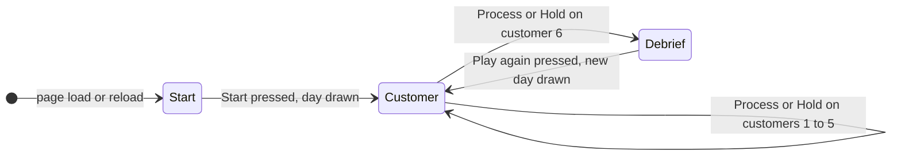

# Hold the Line: design

Version 2, Fri Nov 27, 2026. Built on [requirements.md](requirements.md) version 4. Version 1 covered the game flow and the data schema. Version 2 applies Jeff's review of it (`told` in every question set, the cover-story rule, a harder example customer) and adds the UI and UX plan, the wireframes, and the UI decisions. The system architecture and the technical decisions are in [architecture.md](architecture.md).

## 1. Game flow

The game is in one of three phases. The whole game state is the value below, held in memory only.



### 1.1 State and actions

```ts
// src/game/types.ts (game state)

export type Decision = 'process' | 'hold';

/** What the player did with one customer. results[i] belongs to day[i]. */
export interface CustomerResult {
  asked: QuestionId[];
  decision: Decision;
}

export type GameState =
  | { phase: 'start' }
  | {
      phase: 'customer';
      day: Customer[]; // the 6 customers, in drawn order
      index: number; // which customer is at the window, from 0
      asked: QuestionId[]; // questions asked of this customer so far
      results: CustomerResult[]; // one per customer already decided
    }
  | { phase: 'debrief'; day: Customer[]; results: CustomerResult[] };

export type Action =
  | { type: 'startDay'; day: Customer[] }
  | { type: 'ask'; questionId: QuestionId }
  | { type: 'decide'; decision: Decision };

export const MAX_QUESTIONS = 3;
```

### 1.2 Transitions

| In phase | Action | Allowed when | Result | Covers |
|---|---|---|---|---|
| `start` or `debrief` | `startDay` | Always | `customer`, with the new day, `index` 0, and nothing asked or decided | FR-2, FR-10, AC-7.1 |
| `customer` | `ask` | The current customer has an answer to the question, it has not been asked, and fewer than 3 have been asked | Same phase, with the question added to `asked` | FR-4, FR-5, AC-3.2, AC-3.3 |
| `customer` | `decide` | A customer after this one remains | Same phase: the result is recorded, `index` goes up by 1, `asked` is emptied | FR-6, AC-4.1, AC-4.2 |
| `customer` | `decide` | This is the last customer | `debrief`, with all 6 results | FR-8, AC-6.1 |
| Any | Any other combination | | The state is returned unchanged. No action goes back to an earlier customer | AC-4.3 |

### 1.3 What each phase can show

| Phase | On screen | Never on screen |
|---|---|---|
| `start` | Title, how-to-play text, Start, best score | The number or range of scams (FR-1) |
| `customer` | "Customer *n* of 6", name, slip, behaviour text, the 5 questions, the answers revealed so far, questions left, Process and Hold | Truth, red flags, scam type, explanation, score, right or wrong for any earlier customer (FR-7) |
| `debrief` | Score, and for each customer the call, the truth, right or wrong, the flags with their status, and the explanation | |

### 1.4 What the debrief is built from

`buildDebrief(day, results)` turns the day and the player's results into the value the debrief screen renders. Nothing in it is stored.

```ts
// src/game/debrief.ts

export type FlagStatus = 'shown' | 'asked' | 'notAsked';

export interface DebriefFlag {
  id: RedFlagId;
  shownIn: RedFlag['shownIn'];
  /** shown: on the slip or in the behaviour. asked: behind a question the
   *  player asked. notAsked: behind a question the player did not ask. */
  status: FlagStatus;
}

export interface DebriefRow {
  customer: Customer;
  decision: Decision;
  correct: boolean;
  points: number; // +10, -10, or -30
  flags: DebriefFlag[]; // slip, then behaviour, then answers in bank order. Empty for a legit customer
}

export interface Debrief {
  score: number; // 0 to 60, from scoreDay
  scams: number;
  scamsHeld: number;
  legit: number;
  legitProcessed: number;
  rows: DebriefRow[]; // in the order played
}
```

### 1.5 Flow decisions

| # | Decision | Considered | Why |
|---|---|---|---|
| G1 | Three phases and nothing between them. A decision takes effect on one press | A "next customer" screen between customers; an "are you sure?" step before a decision | AC-4.2 says either button moves to the next customer. A screen in between would have nothing to show, because FR-7 forbids feedback. A confirm step doubles the presses for 6 decisions. A slip is guarded against by the layout instead (U3 and D19). |
| G2 | The reducer ignores an action that is not allowed and returns the same state | Throwing an error; trusting the UI to disable the buttons | The UI disables what cannot be pressed, and the reducer is the backstop. AC-3.2 and AC-3.3 then become unit tests: dispatch a fourth question, or the same one twice, and expect no change. An error would crash the game over a double press. |
| G3 | The state stores what the player did, not what it means. The score and the flag statuses are worked out from `day` and `results` at the debrief | Keeping a running score in the state | Nothing derived can drift out of step with what it came from, and a score that does not exist until the debrief cannot be shown early (FR-7, AC-4.3). |
| G4 | The `customer` phase keeps the `Customer` objects in `day`, not ids | Storing ids and looking each one up in the pool | The debrief needs every field of each customer anyway. The objects are never changed, so there is nothing to keep in step. |
| G5 | `startDay` is the only way into a day, from `start` and from `debrief` | A separate `playAgain` action that returns to the start screen first | D8: Play again goes straight to a new day. One action means a replay cannot carry anything over (AC-7.1), because it builds the same fresh state as the first Start. |

## 2. Data schema

The schema is TypeScript types in `src/game/types.ts`. Content in `src/data/` is written against it.

### 2.1 Ids

Each list is an `as const` array. The union type is derived from it, and `validateData` uses the array itself to check ids at runtime.

```ts
// src/game/types.ts (ids)

/** The question bank, in bank order. The wording is in src/data/questions.ts. */
export const QUESTION_IDS = [
  'purpose',
  'recipient',
  'origin',
  'urgency',
  'next',
  'met',
  'verified',
  'told',
] as const;
export type QuestionId = (typeof QUESTION_IDS)[number];

export const TRANSACTION_TYPES = ['cash', 'wire', 'giftCards'] as const;
export type TransactionType = (typeof TRANSACTION_TYPES)[number];

/** The red flags in requirements.md section 7. */
export const RED_FLAG_IDS = [
  'RF-1', 'RF-2', 'RF-3', 'RF-4', 'RF-5', 'RF-6', 'RF-7', 'RF-8', 'RF-9',
  'RF-10', 'RF-11', 'RF-12', 'RF-13', 'RF-14', 'RF-15', 'RF-16', 'RF-17',
] as const;
export type RedFlagId = (typeof RED_FLAG_IDS)[number];

/** Scam types as FinCEN names them. See S6. */
export const SCAM_TYPES = [
  'governmentImposter',
  'bankImpersonation',
  'romance',
  'emergency',
  'lottery',
  'techSupport',
] as const;
export type ScamType = (typeof SCAM_TYPES)[number];
```

### 2.2 Customers

```ts
// src/game/types.ts (customers)

interface SlipBase {
  /** Whole US dollars. */
  amount: number;
  /** One line on the customer's usual activity (D5). */
  accountNote: string;
}
export interface CashSlip extends SlipBase {
  type: 'cash';
}
export interface WireSlip extends SlipBase {
  type: 'wire';
  recipient: string;
  /** Where the money is going, for example "Lisbon, Portugal". */
  destination: string;
}
export interface GiftCardSlip extends SlipBase {
  type: 'giftCards';
  cardCount: number;
  /** At most 500 (FR-13). amount must equal cardCount × valuePerCard. */
  valuePerCard: number;
}
export type Slip = CashSlip | WireSlip | GiftCardSlip;

export interface RedFlag {
  id: RedFlagId;
  /** Where the player can notice it: on the slip, in the behaviour text,
   *  or in this customer's answer to the named question. */
  shownIn: 'slip' | 'behaviour' | QuestionId;
}

interface CustomerBase {
  /** Stable and unique, for example "c03-wire-romance". Used in test messages. */
  id: string;
  name: string;
  slip: Slip;
  /** What the teller sees and hears before asking anything. */
  behaviour: string;
  /** An answer to each of the 5 questions in the slip type's set, and to no other. */
  answers: Partial<Record<QuestionId, string>>;
  /** The debrief line. For a scam it names the scammer's tactic (AC-6.4). */
  explanation: string;
}

export interface ScamCustomer extends CustomerBase {
  truth: 'scam';
  scamType: ScamType;
  /** At least 3: at least 1 on the slip or in the behaviour, and the rest
   *  behind 1 or 2 questions (FR-14, FR-19). */
  redFlags: RedFlag[];
  /** At least 1 source for the scenario, checked in the fact-check. */
  sourceUrls: string[];
}

export interface LegitCustomer extends CustomerBase {
  truth: 'legit';
  /** For a legit customer who looks like a scam (FR-14): the red flag they
   *  resemble, and the question whose answer explains it. */
  lookAlike?: { flag: RedFlagId; explainedBy: QuestionId };
}

export type Customer = ScamCustomer | LegitCustomer;

/** All that CustomerScreen is given. It leaves out the truth, flags, and explanation (FR-7). */
export type CustomerView = Pick<Customer, 'name' | 'slip' | 'behaviour' | 'answers'>;
```

### 2.3 Question bank and sets

The ids and the three sets are locked (D14). The wording is content and can still change in the Gemini content review.

```ts
// src/data/questions.ts
import type { QuestionId, TransactionType } from '../game/types';

export const QUESTION_TEXT: Record<QuestionId, string> = {
  purpose: "What's the money for?",
  recipient: 'Who is it going to, and how do you know them?',
  origin: 'How did this come up?',
  urgency: 'Does it have to be done today?',
  next: 'What happens to it once you leave here?',
  met: 'Have you met them in person?',
  verified: 'Have you double-checked this yourself, by calling a number you already had?',
  told: 'Has anyone told you what to say here, or asked you to keep this quiet?',
};

/** Every customer of a type offers exactly these 5 (FR-18, D13). */
export const QUESTION_SETS: Record<TransactionType, readonly QuestionId[]> = {
  cash: ['purpose', 'origin', 'urgency', 'next', 'told'],
  wire: ['purpose', 'recipient', 'met', 'verified', 'told'],
  giftCards: ['purpose', 'recipient', 'urgency', 'next', 'told'],
};
```

| Question | Cash | Wire | Gift cards | Flags an answer can carry |
|---|---|---|---|---|
| `purpose` | ✓ | ✓ | ✓ | RF-5, RF-7, RF-14 |
| `recipient` | | ✓ | ✓ | RF-5, RF-13, RF-14 |
| `origin` | ✓ | | | RF-7, RF-14 |
| `urgency` | ✓ | | ✓ | RF-5 |
| `next` | ✓ | | ✓ | RF-12, RF-15, RF-16 |
| `met` | | ✓ | | RF-13 |
| `verified` | | ✓ | | RF-6, RF-7 |
| `told` | ✓ | ✓ | ✓ | RF-6, RF-17, rarely (C4) |

`told` is in every set because it is the question closest to the game's premise. RF-3 (the story changes) and RF-4 (will not discuss it) can sit behind any question. Every flag that requirements section 7 lists as showing in answers can be reached in at least one type. Each set was chosen so that every question in it makes sense for any customer of that type: `next` is left out of the wire set because a wire is gone once it is sent, and `met` is left out of the cash set because a withdrawal may be for the customer alone.

`labels.ts` holds three more `Record`s: `RED_FLAG_LABELS` (one short phrase per red flag id, from the "what the player can notice" column of requirements section 7), `SCAM_TYPE_LABELS`, and `TRANSACTION_LABELS`. A `Record` over an id type will not compile with an id missing.

### 2.4 Content rules

These are the rules for writing the 10 customers. The victims in this game have been coached, so a scam customer arrives with a cover story, and most of what they say is that story (FR-19, D18). "Test" means `validateData` checks it. "Review" means it goes on the checklist for the Gemini content review, because code cannot judge it.

| # | Rule | Checked by |
|---|---|---|
| C1 | A scam customer's red flags are behind at most 2 of their 5 answers, and at least 1 | Test (V8, V14) |
| C2 | Use 2 flagged answers unless there is a reason for 1, and put one of them behind the question the slip most invites, such as `next` for gift cards. A player picks 3 of 5 questions. With flags behind 2 answers, picking blind misses both 1 time in 10. With flags behind 1, it misses 4 times in 10, and the call becomes luck | Review |
| C3 | The other 3 or 4 answers are the cover story. They agree with each other and with the slip, and each could be said word for word by a legit customer of the same type | Review |
| C4 | The usual answer to `told` is a denial that reads like a legit customer's. At most 1 scam customer in the pool admits there to being coached or told to keep quiet (RF-6 or RF-17) | Test (V15) |
| C5 | A flagged answer is something a careful reader catches, not a confession. It contradicts the cover story, dodges the question, or mentions a detail from requirements section 7, such as reading out card numbers, a courier, or a crypto ATM | Review |
| C6 | A scam customer's slip and behaviour are things a legit customer could also show. The flags there are real but do not settle it. Where possible, a legit look-alike in the pool shows the same thing | Review |
| C7 | The explanation says what the scammer did and what the customer was told to say. It is the only place the coaching is spelled out for most scam customers | Review |
| C8 | Legit customers are not all at ease. Some are in a hurry, private, or annoyed at being asked, so mood is not a tell | Review |

### 2.5 Example customer

This customer is here to exercise the schema and to show the content rules. It is not one of the 10: the pool is written on Nov 30, and this scenario has not been through the fact-check. Its three sources were opened on Nov 27. F6 describes a fake refund followed by "they refunded you too much money and insist you pay them back with gift cards", F1 describes scammers asking for the card number and PIN, and F8 says "the minute someone tells you to lie to anyone — including bank tellers or investment brokers — stop".

```ts
// Example only. Not part of the pool.
import type { Customer } from '../game/types';

export const exampleCustomer: Customer = {
  id: 'example-gift-refund',
  name: 'Walter Brandt',
  truth: 'scam',
  scamType: 'techSupport',
  slip: {
    type: 'giftCards',
    amount: 3000,
    cardCount: 6,
    valuePerCard: 500,
    accountNote: 'Pension and Social Security deposits, small card purchases. No gift cards before.',
  },
  behaviour:
    'Has one earbud in, and his phone is face-up on the counter with a call running. He reads the number of cards off a note.',
  answers: {
    purpose: "Presents for the grandkids. There are six of them and I never know what they'd like.",
    recipient: 'My grandchildren. Two are at college and the rest are still at home.',
    urgency: "Before five, yes. I'd rather not go into why.",
    next: "I'll scratch off the backs in the car and read the numbers out over the phone.",
    told: 'No. They are presents, like I said.',
  },
  explanation:
    'A fake tech-support agent convinced Walter he had been refunded too much and must return it in gift cards, and told him to say they were presents for his grandchildren.',
  redFlags: [
    { id: 'RF-11', shownIn: 'slip' },
    { id: 'RF-1', shownIn: 'behaviour' },
    { id: 'RF-4', shownIn: 'urgency' },
    { id: 'RF-12', shownIn: 'next' },
  ],
  sourceUrls: [
    'https://consumer.ftc.gov/articles/how-spot-avoid-and-report-tech-support-scams',
    'https://consumer.ftc.gov/articles/avoiding-and-reporting-gift-card-scams',
    'https://consumer.ftc.gov/consumer-alerts/2024/03/sure-ways-spot-scammer',
  ],
};
```

How it follows the content rules:

| Part | What it is | Could a legit customer show it? |
|---|---|---|
| Slip | Six $500 gift cards, a first for this account (RF-11) | Yes. A grandparent buying one card per grandchild |
| Behaviour | On a call, reading from a note (RF-1) | Yes. A spouse or daughter on the line with the list |
| `purpose`, `recipient`, `told` | The cover story: presents for six grandchildren, and a plain denial | Yes, word for word |
| `urgency` | Flagged, RF-4. A deadline he will not explain does not fit presents | Not with this cover story |
| `next` | Flagged, RF-12. Nobody reads a present's card numbers over the phone | No |

A player who asks `purpose`, `recipient`, and `told` hears nothing wrong and has to decide on the slip and the phone call. A player who asks `next` finds it.

What it shows about the schema:

| Rule | In the example |
|---|---|
| The slip carries the type's extra fields (FR-3) | 6 cards at $500, and $3,000 = 6 × $500 |
| Gift cards are at most $500 each (FR-13) | `valuePerCard: 500` |
| Answers to exactly the 5 questions of the type's set (FR-12, FR-18) | The five keys are the `giftCards` set, and `origin`, `met`, and `verified` are absent |
| At least 3 flags, each with an RF id and a place (FR-12) | 4 flags |
| At least 1 flag visible without asking and at least 1 behind a question (FR-14) | RF-11 and RF-1 are up front |
| Flags behind at most 2 answers (FR-19) | Behind `urgency` and `next` only |
| A scam type and a source (FR-12) | `techSupport`, three FTC pages |
| The explanation names the tactic and the cover story, and does not blame (AC-6.4, NFR-11, C7) | It describes what the caller did and what he told Walter to say |
| The debrief can label each flag (FR-9) | A player who asked `purpose`, `urgency`, and `told` gets RF-11 and RF-1 *shown*, RF-4 *you asked*, RF-12 *you didn't ask*. This is the card in the debrief wireframe |

A legit customer has the same base fields, `truth: 'legit'`, and no scam fields. One who looks like a scam adds, for example, `lookAlike: { flag: 'RF-11', explainedBy: 'recipient' }`.

The code blocks in sections 1.1, 1.4, and 2.1 to 2.5 were taken out of this file and compiled together with `tsc --strict` on Nov 27, with no errors. Three broken copies of the example were compiled the same way and each was rejected: a scam customer with no `sourceUrls`, a flag id of `RF-99`, and a cash slip with a `cardCount`.

### 2.6 Validation rules

This is the specification for `validateData` in `src/game/validate.ts`. The types catch a wrong shape while the content is being written. These rules catch what the types cannot, and they run in `npm test`, where types are not checked ([architecture.md](architecture.md) T5). They are numbered in the order they were added.

| # | Rule | Covers |
|---|---|---|
| **Bank** | | |
| V1 | The bank has 8 different question ids, and each has wording | FR-18 |
| V2 | Each transaction type's set is 5 different bank ids | FR-18, AC-8.3 |
| V3 | Every bank id is in at least 1 set | FR-18, AC-8.3 |
| **Each customer** | | |
| V4 | The id is present and not used twice. The name, behaviour, account note, and explanation are not empty. The amount is a whole number above 0 | FR-12 |
| V5 | The answered questions are exactly the set for the slip's type, and no answer is empty | FR-12, FR-18, AC-8.1, AC-8.3 |
| V6 | A wire has a recipient and a destination. Gift cards have a whole number of cards, a value per card of at most 500, and an amount equal to the two multiplied | FR-3, FR-13 |
| V7 | A scam customer has a known scam type, at least 1 source URL starting with `https://`, and at least 3 red flags with known ids, none repeated | FR-12, AC-8.1 |
| V8 | Each of a scam customer's flags shows on the slip, in the behaviour, or behind a question in the customer's set. At least 1 is on the slip or in the behaviour, and at least 1 is behind a question | FR-12, FR-14 |
| V14 | A scam customer's flags are behind at most 2 different questions | FR-19, AC-8.4 |
| V9 | A legit customer's `lookAlike`, if present, names a known flag and a question in the customer's set | FR-14 |
| **Pool** | | |
| V10 | At least 3 scam and 5 legit customers | FR-11, section 6 rule 7 |
| V11 | Each transaction type is used by at least 1 scam and 1 legit customer | FR-13 |
| V12 | No two scam customers have the same scam type | FR-14 |
| V13 | At least 3 legit customers have a `lookAlike` | FR-14 |
| V15 | At most 1 scam customer has RF-6 or RF-17 behind `told` | FR-19, AC-8.4 |

V10 uses the minimum, not 4 and 6, so the test still passes if the pool is cut to 8 (plan section 10).

### 2.7 Schema decisions

| # | Decision | Considered | Why |
|---|---|---|---|
| S1 | The question ids and their order are one array in `types.ts`. The UI lists a customer's questions by filtering that array | Giving each customer an ordered list of questions; a separate order field | "Listed in bank order" (AC-3.1) is then true by construction, however the content is typed. `QUESTION_SETS` is needed only by the validator: at runtime the questions a customer offers are the ones it has answers for. |
| S2 | `answers` is typed loosely as an optional answer per question, and V5 checks it against the set | A generic type that derives the required answer keys from the slip type, so a missing answer is a compile error | `npm test` does not type-check, so V5 is needed either way to meet AC-8.1. The generic version would add a mapped type over three customer variants to catch the same mistake a few seconds sooner. One rule in one place is easier to read and to explain. |
| S3 | A red flag in the data is an id and a place, with no text of its own. The debrief shows the flag's shared label and, for a flag behind a question, that question and the customer's answer (D15) | A sentence written for each flag on each customer; an optional note per flag | Nothing has to be written twice, and the player sees the same name for the same flag on different customers, which is what makes it something to learn. For a flag marked *you didn't ask*, the debrief can show the answer they would have got. |
| S4 | Scam and legit customers are two variants told apart by `truth`. Legit customers have an optional `lookAlike` | One type with optional scam fields; counting look-alikes by hand in the content review | With variants, a legit customer cannot be given red flags and a scam customer cannot compile without them. FR-14's "at least 3 legit customers show a trait and have a question whose answer explains it" cannot be tested unless the content says which customers those are, and `lookAlike` is the smallest field that says it. |
| S5 | The slip is a variant per transaction type. `amount` is on every slip, and V6 checks the gift-card arithmetic | Optional extra fields on one slip type; working the gift-card amount out from the cards | A wire cannot be written without a recipient, and a cash slip cannot have a card count. Keeping `amount` everywhere lets the slip and the debrief print it the same way for all three types, at the cost of one validation rule. |
| S6 | `scamType` is one of six names FinCEN uses | Free text | The advisory names government imposter, romance, emergency or person-in-need, lottery and sweepstakes, and tech and customer support scams (A, pp. 6–7). The trend analysis adds bank impersonation, which RF-7 is about (T, p. 11). Both were read on Nov 27. A fixed list lets V12 compare scam types, and FR-14 asks for types "named in the FinCEN sources". |
| S7 | Ids are checked twice: by the union type when the content is written, and by `validateData` against the `as const` array at test time | The union type only | A flag id typed as `RF-71` is a compile error, but `npm test` does not compile types. The array costs nothing extra, because the type is derived from it. |
| S8 | The cover story is not a field. A cover answer is any answer with no flag behind it, and the coaching is named in `explanation` | A `coverStory` text field; marking each answer as cover or flagged | The flags already say which answers are flagged, so a second marking could disagree with them. V14 counts from the flags. Whether a cover answer reads as legit is a judgment for the content review, which a field would not help. |

## 3. UI and UX plan

The game is three screens of text. The plan allows plain CSS, text, and emoji, and nothing else: no images, icon sets, web fonts, sound, or animation.

### 3.1 Principles

1. **Reading comes first.** The player's job is to read a slip, a sentence about behaviour, and a few answers, then compare them. Text is at least 16 px, lines stay under about 75 characters, and things to compare sit next to each other.
2. **Nothing hints.** Before the debrief, no colour, word, or icon suggests which call is right or how the day is going (FR-7). Process and Hold look equally acceptable.
3. **The debrief teaches.** It is the only feedback in the game, so it gets the most space. Every claim it makes sits next to the evidence: the slip, the behaviour, the question, and the answer.
4. **Words carry the meaning.** Colour and emoji repeat what a word already says. Everything works with the keyboard (NFR-5) and reads correctly with colour removed (NFR-6).
5. **No blame.** The debrief describes what the scammer did (NFR-11), and it says "wrong call", not "you failed".

### 3.2 Start screen

| Element | Content | Covers |
|---|---|---|
| Title and one-line premise | "Hold the Line", "You're the bank teller. Some of today's customers are being scammed." | FR-1 |
| How to play | The text in the wireframe. It says: process or hold, up to 3 of 5 questions, both mistakes cost points and a missed scam costs more, and results come at the end. It says "some" and never a number or range of scams | AC-1.2, AC-1.3 |
| Start the day | The only button. Draws a day and shows customer 1 | FR-2 |
| Best score | "Best score: *N* / 60", only when one is stored | FR-17 |

Everything fits in 1280×720 without scrolling (AC-1.1): the block is about 600 px tall at an 18 px base size.

### 3.3 Customer screen

| Element | Content and behaviour | Covers |
|---|---|---|
| Header | "Hold the Line" and "Customer *n* of 6" | AC-2.1 |
| Name and behaviour | The customer's name as the screen's heading, then the behaviour text | FR-3 |
| Slip | A bordered block in a monospace font, like a printed slip: a title per transaction type, the type's own lines, the total, and "Usual activity" with the account note | FR-3 |
| Question list | A heading "Ask up to 3 questions", "Questions left: *n*", and the customer's 5 questions as buttons in bank order | FR-4, FR-5, AC-3.1 |
| Answer | Appears directly under its question when asked, in quotation marks, and stays there | FR-4 |
| Hold the transaction, Process the transaction | Two buttons of equal size at opposite ends of a bar under both columns. Either one is final and brings the next customer | FR-6, AC-4.1, AC-4.2 |

Slip lines by type:

| Type | Title | Lines |
|---|---|---|
| Cash | CASH WITHDRAWAL | Amount |
| Wire | WIRE TRANSFER | To, Destination, Amount |
| Gift cards | GIFT CARD PURCHASE | Visa gift cards (*count* × *value*), Total |

A question button is in one of three states:

| State | When | Looks like | On press |
|---|---|---|---|
| Available | Not asked, and questions are left | A normal button | Shows the answer under it and takes 1 off the counter |
| Asked | Already asked | Greyed, marked "asked", with its answer under it | Nothing (AC-3.3) |
| Locked | Not asked, and no questions are left | Greyed | Nothing (AC-3.2) |

Nothing on this screen changes when a decision is made except the customer: there is no message, no colour, no sound, and no running score (AC-4.2, AC-4.3).

### 3.4 Debrief screen

The debrief has a score block and then one card per customer, in the order played, all open (AC-6.2).

**Score block**

| Element | Content | Covers |
|---|---|---|
| Score | "*N* / 60", the largest text on the screen | FR-8, AC-6.1 |
| Counts | "*a* of *b* scams stopped. *c* of *d* legitimate customers served." | FR-8 |
| Best score | "Best score: *N* / 60", or "New best score" when this day beat it | FR-17, AC-9.1 |
| Points key | "Right call +10. Legitimate customer held −10. Scam processed −30." When the sum was below 0, it adds "A day cannot score below 0." | Section 5, D2 |
| Play again | In the score block and again after the last card | FR-10 |

**Every card**

| Element | Content |
|---|---|
| Number and name | The position in the day and the customer's name |
| Transaction | One line: "Gift cards: 6 × $500 = $3,000", "Wire: $18,400 to *recipient*, *destination*", or "Cash withdrawal: $9,000" |
| Verdict | "RIGHT CALL +10" or "WRONG CALL −10" or "WRONG CALL −30", at the right of the name |
| What happened | One of the four sentences below |

| The customer was | The player | Sentence | Verdict |
|---|---|---|---|
| A scam | Held | "You held it. It was a scam: *scam type*." | RIGHT CALL +10 |
| A scam | Processed | "You processed it. It was a scam: *scam type*." | WRONG CALL −30 |
| Legit | Processed | "You processed it. It was legitimate." | RIGHT CALL +10 |
| Legit | Held | "You held it. It was legitimate." | WRONG CALL −10 |

**A scam card adds**, in this order:

1. **What happened**: the explanation, which names the scammer's tactic and the cover story (AC-6.4, C7).
2. **What was in front of you**: the slip in one or two lines, with the account note, and the behaviour text. The player cannot go back to a customer, so the evidence is repeated here.
3. **Red flags**: every flag (AC-6.3), each with a status, in this order: slip, behaviour, then answers in bank order.

| Status | When | Shown as |
|---|---|---|
| *shown* | The flag is on the slip or in the behaviour | The label, and "(on the slip)" or "(at the window)" |
| *you asked* | The flag is behind a question the player asked | The label, the question, and the customer's answer |
| *you didn't ask* | The flag is behind a question the player did not ask | The label, the question, and the answer the player would have got |

The label is the flag's shared text from `labels.ts`, the same on every customer (D15). A scam card looks the same whether the call was right or wrong: a player who held a scam on a hunch still sees what they missed (D4).

**A legit card adds** one line, "Why it was fine", with the explanation (FR-9).

Two additions are proposed in D20 and drawn in the wireframe: source links on a scam card, and on a legit look-alike's card the flag it resembled with the question and answer that explain it.

### 3.5 Layout

| | 720 px and wider | Narrower than 720 px |
|---|---|---|
| Page | One centred column, at most 1100 px wide, 24 px side padding | Full width, 16 px side padding |
| Start | Centred block, 640 px wide | Full width |
| Customer | Two columns: name, behaviour, and slip on the left; questions and answers on the right. Decision bar under both, Hold at the left end and Process at the right | One column in the same order. The two decision buttons are full width at the end of the page, Hold first, with a gap between |
| Debrief | Score block, then cards. The verdict sits at the right of the name. Flags are a two-column list: status, then text | The verdict moves under the transaction line. Each flag's status sits above its text |

One breakpoint, done with CSS grid and one media query. Nothing is sticky or fixed, so nothing can cover text at 375 px (NFR-4). Long text wraps and nothing has a fixed width in pixels, so there is no horizontal scroll at 1280 or 375 px (NFR-3, NFR-4). The customer screen fits in 1280×720 with three answers open, so the desktop player compares slip and answers without scrolling. Buttons are at least 44 px tall.

### 3.6 Visual style

One light theme, defined once as CSS custom properties. Contrast ratios were calculated with the WCAG formula, and all text pairs pass NFR-6's 4.5:1.

| Token | Value | Used for | Contrast |
|---|---|---|---|
| `--bg` | `#f4f1ea` | Page background | |
| `--surface` | `#ffffff` | Slip, cards, the how-to-play box | |
| `--text` | `#1f2933` | Body text | 13.1 on `--bg`, 14.8 on `--surface` |
| `--muted` | `#52606d` | Labels such as "Usual activity"; asked and locked questions | 5.7 on `--bg`, 6.5 on `--surface` |
| `--line` | `#857b68` | Borders | 3.7 on `--bg`, 4.2 on `--surface` (not text) |
| `--process` | `#1d4e89` | Process button, Start, Play again, focus ring | White text on it: 8.4 |
| `--hold` | `#8a4b00` | Hold button | White text on it: 6.8 |
| `--right` | `#1b6e3c` | "RIGHT CALL", debrief only | 6.3 on `--surface` |
| `--wrong` | `#a12622` | "WRONG CALL", debrief only | 7.5 on `--surface` |

- **Type:** the system UI font stack for everything, and the system monospace stack for the slip. 18 px base at 720 px and wider, 16 px below. No web font.
- **Process and Hold** are blue and amber, never green and red, so the colour does not say which is the safe choice. Green and red appear only on the debrief, next to the words "RIGHT CALL" and "WRONG CALL".
- **Status chips** on the debrief are text in a bordered box. *shown* and *you asked* have a solid border, and *you didn't ask* a dashed one in `--wrong`, so the missed ones stand out when scanning.
- **Focus** is a 3 px `--process` outline with a 2 px offset on every button and link (NFR-5).
- **Emoji** are decoration next to a word, hidden from screen readers with `aria-hidden`, and never the only label:

| Emoji | Where |
|---|---|
| 🏦 | Before the title |
| 💵 💸 💳 | Before the slip title and the debrief's transaction line: cash, wire, gift cards |
| 🚩 | Before "Red flags" on a scam card |
| ✓ ✗ | Before "RIGHT CALL" and "WRONG CALL" (text characters, not emoji) |

### 3.7 Keyboard and focus

- Every control is a native `<button>`, and the source links are `<a>`. Tab order follows reading order: questions, then Hold, then Process. Enter and Space activate.
- When a screen appears, and when the next customer appears, focus moves to that screen's heading. A keyboard player always starts at the top, a screen reader announces the new customer, and on a phone the page scrolls back to the top.
- Asked and locked questions use `aria-disabled="true"` and ignore presses. They are not given the `disabled` attribute, which would drop keyboard focus when the button that was just pressed becomes disabled.
- A revealed answer is in an `aria-live="polite"` region, so it is read out when it appears.
- There are no keyboard shortcuts for Process and Hold (U3).
- Each screen has one `<h1>`, and debrief cards are `<article>`s with an `<h2>` each, so a screen-reader user can jump between customers.
- All customer text is rendered as React text nodes. `dangerouslySetInnerHTML` is not used anywhere (NFR-9).

## 4. Wireframes

Each screen is drawn at 1280 px and at 375 px. The frames show layout and wording, not exact size, and emoji are left out so the lines stay aligned. The customer is the example from section 2.5. The second debrief card uses placeholders because the real customers are not written yet.

### 4.1 Start screen

1280 px:

```text
+------------------------------------------------------------------------------------------------------+
|                                                                                                      |
|                                            HOLD THE LINE                                             |
|                 You're the bank teller. Some of today's customers are being scammed.                 |
|                                                                                                      |
|                     +-- How to play -------------------------------------------+                     |
|                     | Six customers will come to your window, one at a time.   |                     |
|                     | Some are doing ordinary banking. Some have been tricked  |                     |
|                     | by a scammer, who has told them what to say to you.      |                     |
|                     |                                                          |                     |
|                     | For each customer:                                       |                     |
|                     |   1. Read the slip and notice how they act.              |                     |
|                     |   2. Ask up to 3 of the 5 questions.                     |                     |
|                     |   3. Process the transaction, or hold it.                |                     |
|                     |                                                          |                     |
|                     | A right call scores 10. Holding an honest customer       |                     |
|                     | costs 10. Letting a scam through costs 30.               |                     |
|                     | You find out how you did at the end of the day.          |                     |
|                     +----------------------------------------------------------+                     |
|                                                                                                      |
|                                          [ Start the day ]                                           |
|                                                                                                      |
|                                         Best score: 40 / 60                                          |
|                                                                                                      |
+------------------------------------------------------------------------------------------------------+
```

375 px:

```text
+----------------------------------------+
|                                        |
|             HOLD THE LINE              |
|    You're the bank teller. Some of     |
|      today's customers are being       |
|                scammed.                |
|                                        |
| +-- How to play ---------------------+ |
| | Six customers will come to your    | |
| | window, one at a time.             | |
| | Some are doing ordinary banking.   | |
| | Some have been tricked by a        | |
| | scammer, who has told them what to | |
| | say to you.                        | |
| |                                    | |
| | For each customer:                 | |
| | 1. Read the slip and notice        | |
| |    how they act.                   | |
| | 2. Ask up to 3 of the 5            | |
| |    questions.                      | |
| | 3. Process the transaction,        | |
| |    or hold it.                     | |
| |                                    | |
| | A right call scores 10. Holding an | |
| | honest customer costs 10. Letting  | |
| | a scam through costs 30.           | |
| | You find out how you did at the    | |
| | end of the day.                    | |
| +------------------------------------+ |
|                                        |
| [           Start the day            ] |
|                                        |
|          Best score: 40 / 60           |
|                                        |
+----------------------------------------+
```

### 4.2 Customer screen

The player has asked `purpose` and `urgency` and has 1 question left. 1280 px:

```text
+------------------------------------------------------------------------------------------------------+
| Hold the Line                                                                        Customer 1 of 6 |
+------------------------------------------------------------------------------------------------------+
|                                                |                                                     |
| Walter Brandt                                  | Ask up to 3 questions             Questions left: 1 |
|                                                |                                                     |
| Has one earbud in, and his phone is face-up on | [ What's the money for?                     asked ] |
| the counter with a call running. He reads the  |     "Presents for the grandkids. There are six of   |
| number of cards off a note.                    |     them and I never know what they'd like."        |
|                                                |                                                     |
| +--------------------------------------------+ | [ Who is it going to, and how do you know them?   ] |
| | GIFT CARD PURCHASE                         | |                                                     |
| |                                            | | [ Does it have to be done today?            asked ] |
| | Visa gift cards    6 x $500                | |     "Before five, yes. I'd rather not go into why." |
| | Total              $3,000                  | |                                                     |
| |                                            | | [ What happens to it once you leave here?         ] |
| | Usual activity     Pension and Social      | |                                                     |
| |                    Security deposits,      | | [ Has anyone told you what to say here, or asked  ] |
| |                    small card purchases.   | |   you to keep this quiet?                           |
| |                    No gift cards before.   | |                                                     |
| +--------------------------------------------+ |                                                     |
|                                                                                                      |
+------------------------------------------------------------------------------------------------------+
| [ Hold the transaction ]                                                 [ Process the transaction ] |
+------------------------------------------------------------------------------------------------------+
```

375 px:

```text
+----------------------------------------+
| Hold the Line          Customer 1 of 6 |
+----------------------------------------+
|                                        |
| Walter Brandt                          |
|                                        |
| Has one earbud in, and his phone is    |
| face-up on the counter with a call     |
| running. He reads the number of cards  |
| off a note.                            |
|                                        |
| +------------------------------------+ |
| | GIFT CARD PURCHASE                 | |
| |                                    | |
| | Visa gift cards   6 x $500         | |
| | Total             $3,000           | |
| |                                    | |
| | Usual activity                     | |
| | Pension and Social Security        | |
| | deposits, small card purchases. No | |
| | gift cards before.                 | |
| +------------------------------------+ |
|                                        |
| Ask up to 3 questions                  |
| Questions left: 1                      |
|                                        |
| [ What's the money for?        asked ] |
|   "Presents for the grandkids. There   |
|   are six of them and I never know     |
|   what they'd like."                   |
|                                        |
| [ Who is it going to, and how do you ] |
|   know them?                           |
|                                        |
| [ Does it have to be done      asked ] |
|   today?                               |
|   "Before five, yes. I'd rather not go |
|   into why."                           |
|                                        |
| [ What happens to it once you leave  ] |
|   here?                                |
|                                        |
| [ Has anyone told you what to say    ] |
|   here, or asked you to keep this      |
|   quiet?                               |
|                                        |
+----------------------------------------+
| [        Hold the transaction        ] |
|                                        |
| [      Process the transaction       ] |
+----------------------------------------+
```

### 4.3 Debrief screen

A day with 2 scams. The player asked Walter `purpose`, `urgency`, and `told`, then processed the transaction. The other five calls were right, so the score is 5 × 10 − 30 = 20. 1280 px:

```text
+------------------------------------------------------------------------------------------------------+
| Hold the Line                                                                             End of day |
+------------------------------------------------------------------------------------------------------+
|                                                                                                      |
|    20 / 60       1 of 2 scams stopped. 4 of 4 legitimate customers served.            [ Play again ] |
|                  Best score: 40 / 60                                                                 |
|                                                                                                      |
|    Right call +10.  Legitimate customer held -10.  Scam processed -30.                               |
|                                                                                                      |
+------------------------------------------------------------------------------------------------------+
|  1   Walter Brandt                                                                  WRONG CALL   -30 |
|      Gift cards: 6 x $500 = $3,000                                                                   |
|      You processed it. It was a scam: tech support scam.                                             |
|                                                                                                      |
|      What happened                                                                                   |
|      A fake tech-support agent convinced Walter he had been refunded too much and must return it in  |
|      gift cards, and told him to say they were presents for his grandchildren.                       |
|                                                                                                      |
|      What was in front of you                                                                        |
|      Slip      6 Visa gift cards at $500. Usual activity: Pension and Social Security deposits,      |
|                small card purchases. No gift cards before.                                           |
|      Window    Has one earbud in, and his phone is face-up on the counter with a call running. He    |
|                reads the number of cards off a note.                                                 |
|                                                                                                      |
|      Red flags                                                                                       |
|      [ shown ]          Buying many gift cards at once  (on the slip)                                |
|      [ shown ]          On the phone during the transaction  (at the window)                         |
|      [ you asked ]      Suddenly unwilling to talk about the money                                   |
|                         Question  Does it have to be done today?                                     |
|                         Answer    "Before five, yes. I'd rather not go into why."                    |
|      [ you didn't ask ] The card numbers will be read out to someone                                 |
|                         Question  What happens to it once you leave here?                            |
|                         Answer    "I'll scratch off the backs in the car and read the numbers out    |
|                                   over the phone."                                                   |
|      Read more: consumer.ftc.gov (3 links)                                                           |
+------------------------------------------------------------------------------------------------------+
|  2   <name>                                                                         RIGHT CALL   +10 |
|      <transaction summary>                                                                           |
|      You processed it. It was legitimate.                                                            |
|                                                                                                      |
|      Why it was fine                                                                                 |
|      <explanation>                                                                                   |
|                                                                                                      |
|      What could look like a red flag                                                                 |
|      <flag label>                                                                                    |
|      Question  <the question that explains it>                                                       |
|      Answer    <this customer's answer>                                                              |
+------------------------------------------------------------------------------------------------------+
|  3 to 6   the remaining customers, in the order played                                               |
+------------------------------------------------------------------------------------------------------+
|                                                                                       [ Play again ] |
+------------------------------------------------------------------------------------------------------+
```

375 px:

```text
+----------------------------------------+
| Hold the Line               End of day |
+----------------------------------------+
|                                        |
|                20 / 60                 |
|          Best score: 40 / 60           |
|                                        |
| 1 of 2 scams stopped.                  |
| 4 of 4 legitimate customers served.    |
|                                        |
| [             Play again             ] |
|                                        |
| Right call +10.                        |
| Legitimate customer held -10.          |
| Scam processed -30.                    |
+----------------------------------------+
| 1  Walter Brandt                       |
| Gift cards: 6 x $500 = $3,000          |
|                                        |
| WRONG CALL                         -30 |
| You processed it.                      |
| It was a scam: tech support scam.      |
|                                        |
| What happened                          |
| A fake tech-support agent convinced    |
| Walter he had been refunded too much   |
| and must return it in gift cards, and  |
| told him to say they were presents for |
| his grandchildren.                     |
|                                        |
| What was in front of you               |
| Slip: 6 Visa gift cards at $500. Usual |
| activity: Pension and Social Security  |
| deposits, small card purchases. No     |
| gift cards before.                     |
| Window: Has one earbud in, and his     |
| phone is face-up on the counter with a |
| call running. He reads the number of   |
| cards off a note.                      |
|                                        |
| Red flags                              |
| [ shown ] on the slip                  |
| Buying many gift cards at once         |
|                                        |
| [ shown ] at the window                |
| On the phone during the transaction    |
|                                        |
| [ you asked ]                          |
| Suddenly unwilling to talk about the   |
| money                                  |
|   Question: Does it have to be done    |
|   today?                               |
|   Answer: "Before five, yes. I'd       |
|   rather not go into why."             |
|                                        |
| [ you didn't ask ]                     |
| The card numbers will be read out to   |
| someone                                |
|   Question: What happens to it once    |
|   you leave here?                      |
|   Answer: "I'll scratch off the backs  |
|   in the car and read the numbers out  |
|   over the phone."                     |
|                                        |
| Read more: consumer.ftc.gov            |
+----------------------------------------+
| 2  <name>                              |
| <transaction summary>                  |
|                                        |
| RIGHT CALL                         +10 |
| You processed it.                      |
| It was legitimate.                     |
|                                        |
| Why it was fine                        |
| <explanation>                          |
|                                        |
| What could look like a red flag        |
| <flag label>                           |
|   Question: <the one that explains it> |
|   Answer: <this customer's answer>     |
+----------------------------------------+
| 3 to 6, in the order played            |
+----------------------------------------+
| [             Play again             ] |
+----------------------------------------+
```

## 5. UI decisions

| # | Decision | Considered | Why |
|---|---|---|---|
| U1 | From 720 px up, the customer screen is two columns: who and what on the left, questions on the right, decisions in a bar under both | One column at every width; questions under the slip; tabs | The game is comparing an answer with the slip. Side by side, both are visible at 1280×720 with three answers open. Tabs would hide one while reading the other. |
| U2 | An answer appears under its question and stays | A transcript panel in the order asked; a popup | FR-4 needs answers to stay visible. Under the question, each answer keeps its question, and the list never reorders because bank order is fixed. The cost is that the buttons below move down when an answer opens. |
| U3 | Hold and Process are the same size, at opposite ends of the bar, blue and amber, with no keyboard shortcut | Side by side; one styled as the main action; green and red; H and P keys | A decision is final (FR-6), so the two must be hard to confuse and hard to hit by accident. A main-action style or a green button would say which call the game expects, which FR-7 forbids in spirit. A shortcut would make one stray key cost up to 40 points. |
| U4 | Hold and Process ignore presses for the first half second after a customer appears (D19) | No guard; a confirm step (G1) | Each decision puts the next customer's buttons where the last ones were, so a double-click decides two customers. Ray, the persona who is not a gamer, is the player most likely to double-click. |
| U5 | The debrief is one page with all six cards open, in the order played | Collapsed rows that open on a click; wrong calls first; one customer per page with a Next button | AC-6.2 fixes the order. With everything open, nothing is missed for want of a click, and a keyboard player only scrolls. A pager would add a position to the game state for the screen that should be simplest to use. |
| U6 | A scam card repeats the slip and the behaviour text above the flags | Only the name and transaction that FR-8 asks for | A flag marked *shown* teaches nothing unless the player can look again at what was shown, and there is no way back to the customer (AC-4.3). D15's labels are general, so the specific evidence has to sit beside them. |
| U7 | A flag is a text status, a label, and for flags behind a question the question and the answer, whether or not it was asked | Colour or an icon alone for the status; hiding the answers to questions not asked | The status has to survive without colour (NFR-6). The answer the player did not hear is the most useful line on the screen: it shows exactly what one more question would have got them. |
| U8 | The score block gives the number, the counts, and the points key. Each card shows its own points. Play again is at the top and the bottom | The number alone; the full sum written out | The counts and the per-card points explain the number, and the player can add the cards up to check it. Writing out the sum would show the negative total that D2 hides. The page is long, so the button is at both ends. |
| U9 | Focus moves to the heading when a screen or a customer appears. Unavailable questions use `aria-disabled` | Leaving focus where it was; the `disabled` attribute | Without it, focus stays on a button that has been replaced, and a held Enter key would decide the next customer too. `disabled` drops focus from the button just pressed, which leaves a keyboard player at the top of the page after every question. |
| U10 | One breakpoint at 720 px, system fonts, and one light theme with measured contrast | More breakpoints; a web font; a dark theme | NFR-3 and NFR-4 name two widths, and one breakpoint serves both. A web font is either a request to another origin, which NFR-1 rules out, or weight in the bundle. A dark theme doubles the contrast checks for what the plan calls polish. |
| U11 | Emoji are decoration beside a word and hidden from screen readers | Emoji as the only label on a button or status; an SVG icon set | Emoji look different on every system and can be missing. The plan allows emoji and rules out custom art, so they are used where losing one costs nothing. |
| U12 | On a phone the decision buttons are at the end of the page, in the normal flow | A bar fixed to the bottom of the screen | A fixed bar covers text at 375 px, which NFR-4 does not allow, and it keeps a final decision under the player's thumb while they scroll. |

## 6. Decisions

The numbering continues from [requirements.md section 8](requirements.md#8-decisions). D16 and D17 are about tooling and are in [architecture.md section 7](architecture.md#7-decisions-for-jeff). D19 and D20 are waiting for Jeff.

| # | Decision | Outcome or recommendation | Why | Status |
|---|---|---|---|---|
| D14 | The question bank: 8 ids, their wording, and the set of 5 for each transaction type | As in section 2.3. `told` is in every set; on gift cards it replaced `verified` | The ids and sets are part of the schema and decide which flags a customer of each type can hide behind a question. Jeff's change: `told` is the question closest to the game's premise, so every customer offers it. The ids and sets are locked; the wording can still change. | Approved by Jeff with one change, Nov 27 |
| D15 | What the debrief says about a flag | The flag's shared label, plus the question and the customer's own answer when the flag is behind a question. No sentence written per customer per flag | It removes 12 or more sentences from the content work on Nov 30, which is the plan's top risk. A flag on the slip or in the behaviour gets its general label next to the slip and behaviour text themselves (U6). | Approved by Jeff, Nov 27 |
| D18 | Cover stories | A scam customer has flags behind at most 2 of 5 answers. The others are the cover story and read like a legit customer's. The slip and behaviour are things a legit customer could also show. An admission on `told` is rare, which this document sets at 1 scam customer at most (FR-19, C1 to C7, V14, V15) | Jeff's review of version 1: the example gave itself away before any question and all five answers sounded like a scam, so no question was worth asking, and whatever is in this document is what gets copied for the real 10. The victims are coached, so they should arrive with a story. "At most 1" is the AI's reading of "rare", chosen so a test can check it. | Decided by Jeff, Nov 27 |
| D19 | A guard against deciding twice | Hold and Process ignore presses for the first half second after a customer appears (U4) | A double-click on Process would otherwise process the next customer unseen, at a cost of up to 40 points with no way back. It is one timer in `CustomerScreen`, and the reducer stays pure. Without it, the manual test plan should include a double-click case. | Recommended |
| D20 | Two things on the debrief that FR-9 does not ask for | (a) On a scam card, a "Read more" line linking to the customer's source URLs. (b) On a legit look-alike's card, the flag it resembled and the question and answer that explain it | Both are built from data the schema already holds (`sourceUrls`, `lookAlike`), so they add no content work. (a) lets Ray check that the scams are real and read further. The links open the FTC in a new tab, which `security.md` has to cover. (b) is the lesson a look-alike exists to teach: a red flag is a reason to ask, not proof. Either can be left out without changing anything else. | Recommended |
